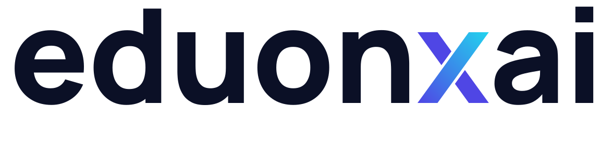

  

# EduonxAI

AI study platform for Indian competitive exam prep (JEE, NEET, GATE and state government exams).

## Features

- AI tutoring on any subject
- Personalized quizzes and progress tracking
- Daily study streaks and leaderboards
- Google OAuth and email/password login

## Brand assets

Logo concepts live in `assets/v5/` (concept board: `board.png`). A final direction has not been chosen yet.

## Design system

| Token | Value |
|---|---|
| Primary | `#4338CA` (indigo) |
| Secondary | `#2563EB` (blue) |
| CTA / accent | `#F59E0B` (amber) |
| Background | `#F8FAFC` |
| Surface | `#FFFFFF` |
| Text | `#0F172A` |

Typography: Plus Jakarta Sans (headings) and Inter (body). Style: flat, AI-native, friendly. Tokens live in `design-tokens.css`.
